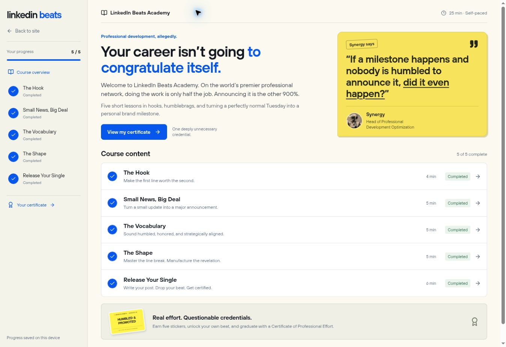

# Learning portal UI

The `/learn/` course uses a quiet cream focus-mode shell and LinkedIn-style
practice cards. The site menu exposes it as **Learn**. Existing `/program/`
bookmarks still work and share the same saved progress.

- Read, see an example, understand the changes, try it, review the takeaways.
- Earlier content stays in the reading column. Completed controls cannot skip
  later steps. The rail becomes a sticky course menu on narrow screens.
- A sticker is earned at each chapter end. Finishing all five unlocks a
  personalized Certificate of Professional Effort and the saved final post's
  existing beat player. PNG downloads are created locally from SVG artwork.
- Existing `lb_program_v1` progress is retained. Persistence is by chapter;
  reopening an unfinished lesson restarts its walkthrough.

## Compact Academy layout

The overview is now branded **LinkedIn Beats Academy**. A shorter introduction
and bold yellow Synergy instructor card sit side by side on desktop. Five
72 px syllabus rows show lesson summaries, durations, and completion states.
At widths below 991 px, the syllabus comes before the instructor card.

The course shell uses Hoves sans-serif labels instead of uppercase monospace.
The rail is narrower, lesson headings and vertical gaps are smaller, and a
Course overview breadcrumb replaces the extra lesson labels. Feed cards retain
their 556 px cap and LinkedIn typography; lesson data, saved progress, recap
videos, and reward behavior are unchanged.

Verified the desktop overview, enrollment and first worked example, the mobile
course menu and lesson transition, and mobile/tablet layouts without horizontal
overflow. Program validation (5 chapters / 74 steps) and the full build pass.

## Feed polish and Synergy recaps

The introduction now pitches professional development optimization with a more
pointed corporate satire. Lesson prose and post previews use a narrower reading
column; feed cards cap at 556 px and switch to compact Arial/system typography.
Posts preserve line breaks, expand with “…more,” and include a profile header,
post-options copy menu, reaction totals and local practice actions. Social state
is ephemeral; no content is published or sent to LinkedIn.

Vocabulary and Shape end with optional Synergy video recaps before their sticker.
These use the existing Caffeinated Edition and current masterclass recut, not new
recordings. The recap block includes native playback controls, a written summary,
a failure fallback and a Continue button that pauses the film. Watching is optional.

Both production film URLs were verified in a real browser (50 s / 44 s, playing,
readyState 4). The dev media proxy did not stream them, so media playback was
checked using their production URLs in an isolated preview fixture. The actual
lesson uses same-origin URLs in production. The fixture is not shipped.

Browser checks cover post expansion, local likes/comments, mobile layout at
375 px content width without horizontal overflow, and video pause on Continue.
`check:program` validates 74 steps including the new recap fields. Build passes.

## Original implementation captures

Synthetic learner data is used in these browser screenshots.

## Verification

`npm run check:program`, `npm run check:home2`, and the complete Vite build pass.
The program checks include old progress migration, malformed stored data and
in-memory progress when storage is blocked.

Browser checks covered all five lessons, personalization, generator outputs,
dial changes, quiz feedback and retry, humanizing the original exercise input,
sticker download, certificate gating, a 2400 × 1700 certificate PNG download,
and completed progress after reload. The 390 px iframe check verified the
mobile menu, sticky header, feed layout and absence of horizontal overflow.

The final beat player rendered and accepted play, but its existing vocal
service returned “The vocals couldn’t be prepared.” Audio playback and audio
exports were not verified in this environment. The service is unchanged by
this UI work. Certificate print styles are included; PNG export was the
browser-verified download path.
