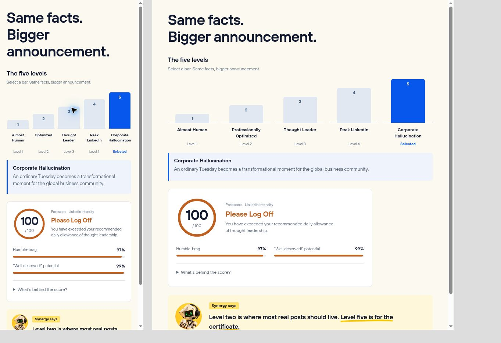
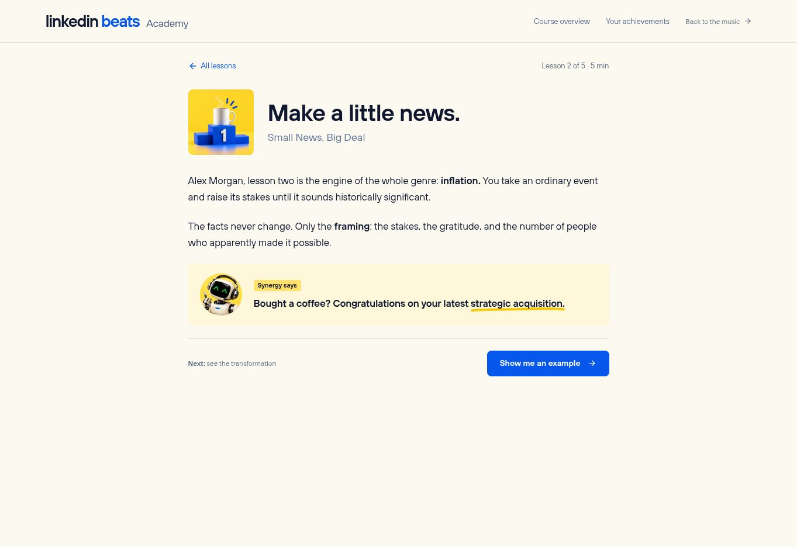
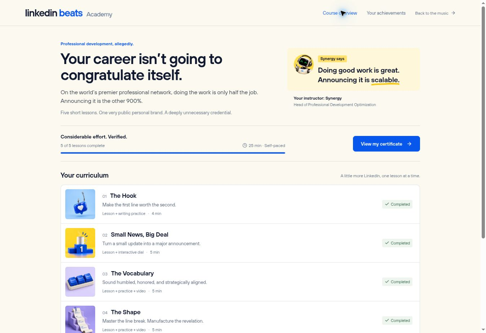
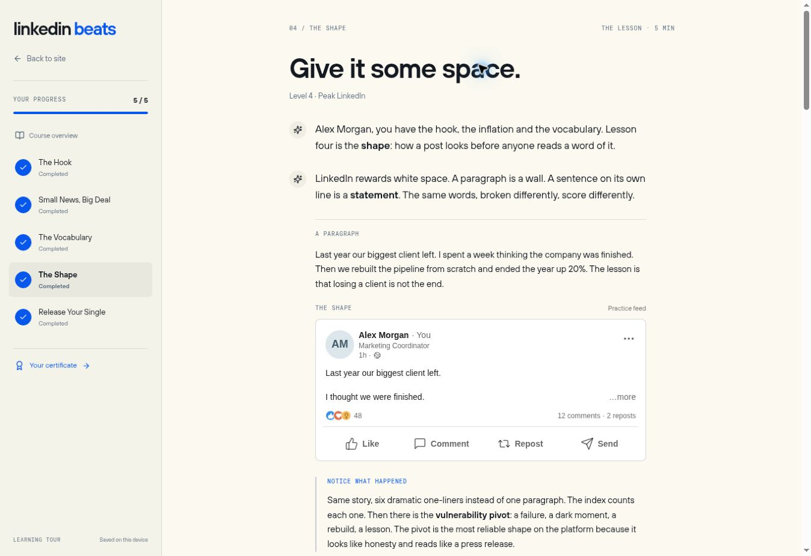
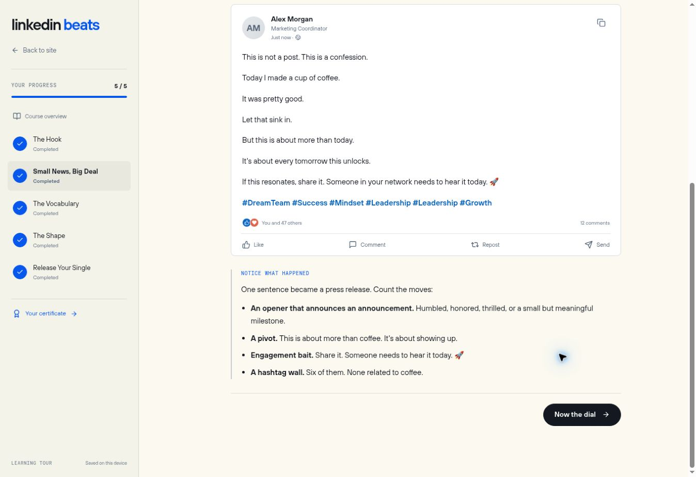
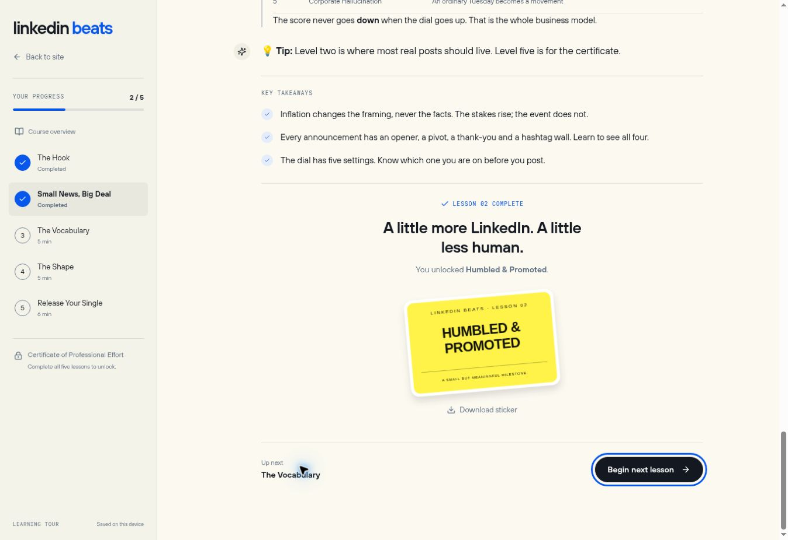
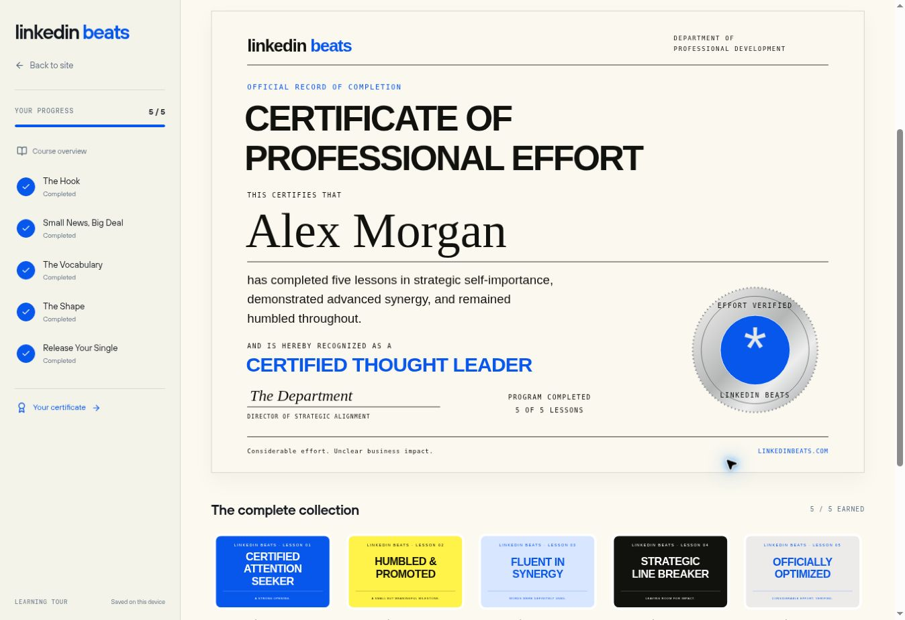

# Learning portal UI

The `/learn/` course uses a quiet cream focus-mode shell and LinkedIn-style
practice cards. The site menu exposes it as **Learn**. Existing `/program/`
bookmarks still work and share the same saved progress.

- Read, see an example, understand the changes, try it, review the takeaways.
- Earlier content stays in the reading column. Completed controls cannot skip
  later steps. A slim Academy header replaces the persistent sidebar; mobile
  navigation opens only when requested.
- A sticker is earned at each chapter end. Finishing all five unlocks a
  personalized Certificate of Professional Effort and the saved final post's
  existing beat player. PNG downloads are created locally from SVG artwork.
- Existing `lb_program_v1` progress is retained. Persistence is by chapter;
  reopening an unfinished lesson restarts its walkthrough.

## Illustrated Academy lessons

### Level charts, score gauges, and Synergy v2

`components/LevelChart.jsx` renders five ascending ordinal bars using the
generator's existing level names and descriptions. In a `dial` step, selecting
a bar regenerates the same announcement and score immediately. Native radios
support touch and arrow keys; completed practice controls are disabled. The
passive `{type: 'level-chart', id, title?, caption?}` step replaces the five-level
Markdown table and lets learners explore the definitions without another gate.
Bar height represents level, not a predicted post score.

`components/PostScore.jsx` uses the existing scorer without changing its math.
An accessible 0–100 ring displays the exact index and named rank. Humble-brag
and the satirical “Well deserved!” probability have percentage bars; counts
and gratitude details stay available in a native disclosure. Reduced-motion
preferences suppress transitions. Higher scores mean more LinkedIn intensity,
not better work.

The instructor portraits now retain the real Synergy's angular diamond head,
headset, coffee and small square green LED eyes. The expression is restrained
and enthusiastic. The two 512 px v2 WebPs total 71 KB and are used in tips,
the overview, completion and recap headings. Previous portrait files remain
available. Built-in imagegen edit prompts are in `synergy-v2-prompts.json`.

Browser verification covered 375 px and 805 px content widths without overflow,
pointer and keyboard level selection, live score updates, and score disclosure.

The approved lesson design is implemented: a centered 720 px reading column,
112 px lesson artwork (76–88 px on phones), navy Hoves headings, cobalt actions,
and a compact pale-yellow Synergy note. The overview uses thumbnail lesson rows
and a single progress/continue area. `/learn/#/achievements` shows earned sticker
downloads, locked rewards, and the certificate entry point.

Five generated lesson covers and two matching Synergy portraits live in
`public/learn/art/`. The seven 512 × 512 WebP assets total about 160 KB. Their
original prompts and generator are recorded in `illustrated-assets.json`.
`underline.svg` is a small vector brushstroke, applied to real selectable text
with per-line wrapping. It is not baked into the image.

`SynergyTip` is shared by lessons, the overview, and completion screens. Author
`{type: 'synergy-tip', id, content}` in a chapter; `**bold**` phrases receive the
yellow underline. These are passive teaching steps, not new interaction gates.
`chapters/presentation.js` controls the lesson headings, art, overview summaries,
and format labels. A pause can supply `nextLabel` alongside its button label.

Existing examples, exercises, local generator, video recaps, chapter-level
progress, and reward exports are retained. No new API or API key is required.

Browser verification: desktop and 390 px mobile lesson layouts; mobile overview
at 375 px and tablet at 805 px content width without horizontal overflow; menu
navigation; coffee performance; expanded/liked post surviving advancement;
announcement generation; dial at level five; lesson completion, sticker PNG
download, achievements and certificate navigation. Program validation passes
with 5 chapters / 79 steps. The complete Vite build passes. The existing beat
service and recap films are unchanged; playback was not re-tested in this pass.

## Feed polish and Synergy recaps

The introduction now pitches professional development optimization with a more
pointed corporate satire. Lesson prose and post previews use a narrower reading
column; feed cards cap at 556 px and switch to compact Arial/system typography.
Posts preserve line breaks, expand with “…more,” and include a profile header,
post-options copy menu, reaction totals and local practice actions. Social state
is ephemeral; no content is published or sent to LinkedIn.

Vocabulary and Shape end with optional Synergy video recaps before their sticker.
These use the existing Caffeinated Edition and current masterclass recut, not new
recordings. The recap block includes native playback controls, a written summary,
a failure fallback and a Continue button that pauses the film. Watching is optional.

Both production film URLs were verified in a real browser (50 s / 44 s, playing,
readyState 4). The dev media proxy did not stream them, so media playback was
checked using their production URLs in an isolated preview fixture. The actual
lesson uses same-origin URLs in production. The fixture is not shipped.

Browser checks cover post expansion, local likes/comments, mobile layout at
375 px content width without horizontal overflow, and video pause on Continue.
The earlier feed-polish pass validated 74 steps including the recap fields.
The illustrated pass above now includes five additional instructor notes.

## Original implementation captures

Synthetic learner data is used in these browser screenshots.

## Verification

`npm run check:program`, `npm run check:home2`, and the complete Vite build pass.
The program checks include old progress migration, malformed stored data and
in-memory progress when storage is blocked.

Browser checks covered all five lessons, personalization, generator outputs,
dial changes, quiz feedback and retry, humanizing the original exercise input,
sticker download, certificate gating, a 2400 × 1700 certificate PNG download,
and completed progress after reload. The 390 px iframe check verified the
mobile menu, sticky header, feed layout and absence of horizontal overflow.

The final beat player rendered and accepted play, but its existing vocal
service returned “The vocals couldn’t be prepared.” Audio playback and audio
exports were not verified in this environment. The service is unchanged by
this UI work. Certificate print styles are included; PNG export was the
browser-verified download path.
