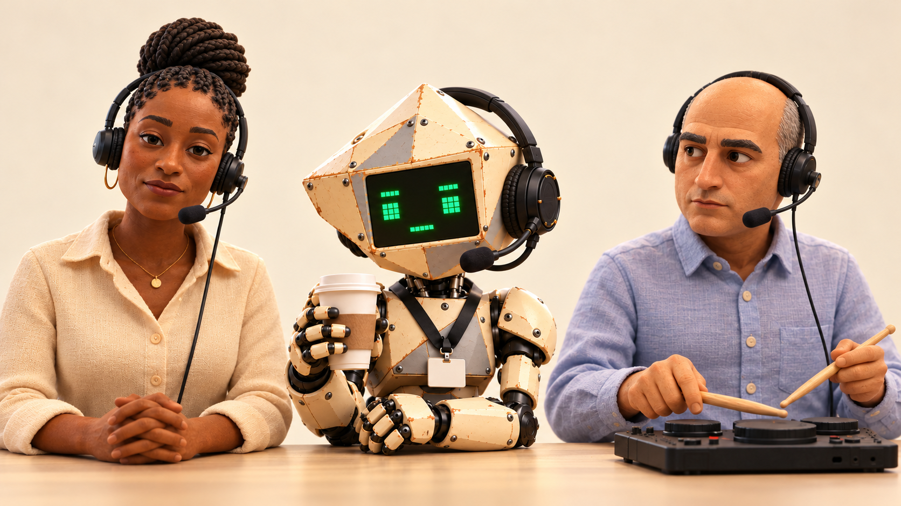

# LinkedIn Beats characters and animation

**Current pilot direction, October 29:** Aaron prefers the original-photo cast. Use real listening/blink footage and instrument views where those roles already exist, with paper/collage title branding. The [photo performance kit](episodes/chatgpt-onboarding/photo-plus-version.md) retains all seven human identities, archives six unique supplied Synergy coffee clips, and presents two new robot-voice auditions. Synergy's existing voice remains canonical until a replacement is selected. The expressive digital face in the photo pilot is a deliberate exception to the older fixed-row screen treatment documented below; the live meeting engine is unchanged.

The cast is an office with an internal band. Musical duties follow existing performances where those exist. A character need not hold an instrument to have a useful sonic role. Existing names and voice identities stay stable; proposed motivations develop the characters rather than recasting them.

## Cast

| Character ID | Established office role | Established music or voice | Proposed dramatic function |
| --- | --- | --- | --- |
| `synergy` | Host | Crisp, flat retro formant speech; eSpeak NG | Wants every meeting to end in alignment, even when nobody agrees on what happened |
| `synthia` | Corporate training | Distinct clear Flite digital voice | Makes process teachable, then creates training for the process of learning it |
| `people` | People & Culture, HR | Warm, reassuring human voice; Heart | Needs everyone to feel included; solves an exclusion by adding a committee |
| `strategy` | Strategic alignment | Low, deliberate human voice; Onyx | Keeps widening the scope so the original question never quite applies |
| `guitar` | Kevin, Partnerships | Guitar; conversational human voice, Puck | Wants to contribute something tangible; still cannot access the shared folder |
| `keys` | Keys, Enablement | Keyboard; calm human voice, Bella | Builds helpful systems that quietly create another dependency |
| `operations` | Operational excellence | Drum pad; matter-of-fact human voice, Michael | Wants the task completed and credited; takes authentic pride in a folder rename |
| `accountant` | Arjun, Finance | Precise, restrained human voice; George | Asks the plain question everyone has been avoiding; a straight character, not a snark machine |
| `linda` | Governance | Dry, unhurried human voice; Nicole | Remembers the previous rollout and its original spreadsheet; retains information, not just cynicism |
| `printer` | Deliverables | Silent in meetings | Performs the physical work while everyone debates being paperless |
| `droid` | Internal distribution, paper logistics | Silent in meetings; robotic lead and beeps in its solo film | Treats getting a trolley down a corridor as a consequential professional journey |
| `pat` | Thought leadership | Silent, camera off | Publicly very present; absent when a practical answer is needed |

Do not assign bass guitar, singing or new voices to established people as if these were already approved. Proposed sonic motifs: Synergy supplies clipped calls; Synthia supplies the answering phrase; paper feed becomes percussion; the floor droid contributes short electronic acknowledgements. Bass remains a score part until a performer is deliberately cast.

## Relationships that create scenes

These are starting proposals for a connected season.

- Kevin needs access. People & Culture welcomes him; Keys owns the onboarding system; neither owns access. Synergy closes the discussion as a successful welcome.
- Arjun asks for the result. Strategy explains why the result needs a broader framework. Linda still has the old result in a spreadsheet.
- Operations completes an ordinary task. Synergy needs the announcement; Synthia needs the training material. Operations has to stop working to explain how work happened.
- The printer and floor droid form the only reliable delivery chain. Management repeatedly announces its replacement, then asks for another printed copy.

Allow small changes in status and alliances. Linda can help Kevin. People & Culture can be right. Strategy can occasionally solve something. Repeated characters need more than one reaction.

## Two visual forms of one cast

The filmed Synergy is the identity reference: cream faceted riveted head, black face screen, small green eyes, headset, lanyard, angular armor and exposed joints. The Learn avatar translates these features into a compact dimensional character. It is a different treatment of the same character, not permission to substitute a generic robot.

Human counterparts should use that same translation: retain facial structure, age cues, hair, complexion, wardrobe, headset and instrument; simplify forms enough for clear animation and small-screen recognition. Preserve adult proportions and restrained expressions. The Learn robot’s friendlier presentation can inform materials and lighting without turning every human into a smiling mascot.

The initial cast study uses People & Culture and Operations beside Synergy. It tests whether the human faces belong in that world. It is a still concept, not a rig, animation or approved replacement asset.

## Hand drawn television animation exploration

October 29 direction from Aaron: explore the hand-drawn television-animation language of *The Flying House*, or another animated-series treatment. The sculpted study above is retained as exploration history; it is not a locked production style.

Two new still studies preserve People & Culture, Synergy and Operations, their clothes, headsets and props:

- [Cel adventure study](art/cast-cel-adventure-v1.png): finer drawn facial detail, warm cel colors and a softly painted office. This follows the earnest television-adventure reference most closely.
- [Cel sitcom study](art/cast-cel-sitcom-v1.png): simpler shapes, stronger contours and more economical facial design. The office performance remains understated.

Use the filmed references to check likeness before locking turnarounds. Translate Synergy into the same drawn medium as the humans while preserving his faceted cream head, black screen and green features. The reference concerns animation craft, not religious imagery or copying another show's cast. These are alternative concept frames, not completed animation. Neither is approved as the final series style yet.

Style reference: [The Flying House, Tatsunoko Production](https://tatsunoko.co.jp/en/works/the-flying-house/). Prompts and generation method are recorded in [art prompts](art/prompts.md).

## Watercolor and office material exploration

Aaron liked both cel studies and requested a slightly more minimal watercolor treatment, or office-supply and typewriter textures. These two alternatives retain the same three characters for direct comparison:

- [Ink and watercolor](art/cast-watercolor-v1.png): broken contours, transparent washes and unpainted ivory space; office background fades into the paper.
- [Office paper collage](art/cast-office-paper-v1.png): manila and blue memo-paper shapes, carbon-black lines, copier grain and sparse typewriter-like impressions. Material choices come from the characters' workplace.

Keep skin tones, silhouettes, props and neutral performances recognizable. Treat office textures as construction materials rather than decorative clutter. Sparse ink marks are an exploration of typewriter texture, not readable copy or character labeling. Both remain concept stills. Aaron subsequently selected office paper as the miniseries direction; watercolor remains an exploration. [Recorded prompts](art/material-study-prompts.md).

## Model sheet and motion package

Create one package per character before making new episode footage:

1. Front, three-quarter and profile views; seated webcam portrait; a full-body view when the scene needs it.
2. Neutral, listening, speaking, thinking and one restrained reaction. Headset and clothing stay fixed between poses.
3. Separate mouth, eyes, lids, head, torso, hands and prop layers, or an equivalent consistent 3D rig. A generated still alone is not an animation-ready model.
4. A 6–10 second performance test: idle, blink, listen, short line, return to neutral. Add a separate playing test for Kevin, Keys and Operations.
5. Original human voice identity and stable robot voices. Dialogue clarity takes priority over processing. Only robot characters receive robot treatment by default.
6. Phone-size webcam tile and thumbnail checks alongside the filmed reference. Export approved source, transparent portrait, thumbnail crop and motion assets with a version and provenance record.

Start with People & Culture and Operations, then Kevin and Keys, then Strategy, Arjun and Linda. Reuse the established Synergy and Synthia identities. Pat’s camera-off state is intentional; a face is not required to complete the cast.

## Mechanical continuity

Synergy walks with short restricted steps, rigid torso, bent elbows and little arm swing. His screen mouth in current meeting footage is a fixed-height green horizontal row with brightness movement; do not stretch metal or move the mouth off the screen.

The floor droid is a separate squat cream canister with a dome, dark visor and blue stripe. It rolls on small wheels and tows a connected trolley. No humanoid limbs, rotating duster, stretching tow bar or changing scale.

Printer paper feeds outward with normal sheet dimensions and lands on a matching stack. No reversing, expanding sheets or resetting stacks within a continuous action.

## Office paper scene development

Aaron singled out the office-paper treatment as especially successful and asked to see Synergy typing his LinkedIn post into ChatGPT. The [first desk scene](art/synergy-chatgpt-paper-v1.png) carries the material language into a new composition. See the [scene and reuse plan](art/synergy-chatgpt-scene.md). This establishes a preferred direction for further development, not a finished rig or animation system.

## Selected miniseries direction

Office paper is now the selected series treatment. Follow [the miniseries format](miniseries-format.md) for reusable states, paper meeting windows, timed typography, printer fatigue and Synergy’s coffee action. [The meeting-grid concept](art/paper-meeting-grid-v1.png) is a staging study awaiting review. Selection of the style does not imply that layered assets, rigs or episodes are already complete.
